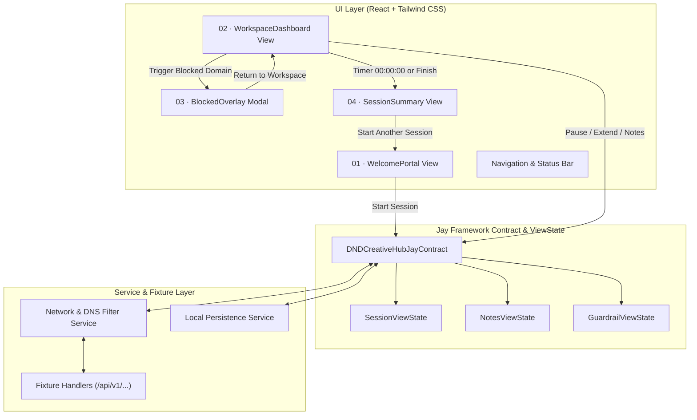
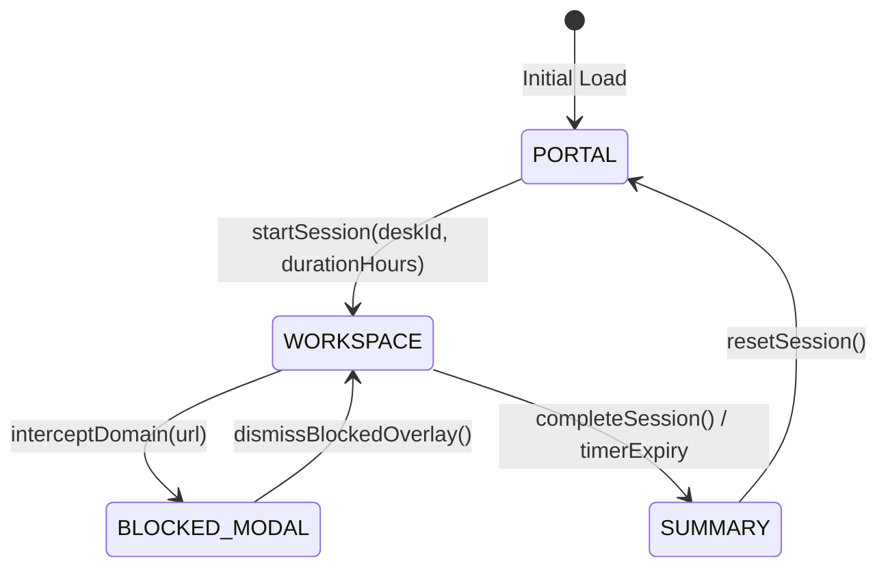

# #0001 - Front-end Client for DND Creative Hub (DNS Focus Portal)

## Background
The DND Creative Hub is a physical and digital deep-work environment where connected users are placed in a distraction-filtered local network. A captive portal / Wi-Fi onboarding kiosk enables users to check in at a designated desk, specify a focus duration block (1h, 2h, 4h), and enter an uninterrupted workspace. During the session:
1. The local DNS service transparently enforces focus rules by intercepting non-whitelisted distraction domains (e.g., social media like `facebook.com`, short-form video, gambling).
2. The user dashboard displays session countdown progress, time saved, synchronous note capture, and a curated filtered media viewer (e.g., YouTube Music, Pinterest inspiration).
3. Attempted access to restricted domains triggers a modal overlay guardrail informing the user of the block, celebrating saved focus time, and allowing immediate return to work.
4. When the session concludes, a checkout summary presents performance metrics (distractions intercepted, focus score, duration) and submits session logs to the local checkout API (`/api/v1/sessions/checkout`).

Prototypes and design specifications are provided in `./prototype/` as high-fidelity screenshots (`00 · User Flow`, `01 · Wi-Fi Welcome Portal`, `02 · Main Workspace Dashboard`, `03 · Website Blocked Overlay`, `04 · Session Complete Summary`).

## Problem
Currently, there is no interactive front-end client implementation. Users connecting to the local node have no interface to:
1. Authenticate or claim a desk session (`POST /api/v1/sessions/start`).
2. Monitor real-time remaining focus time with visual countdown feedback and extension options (`+15 Min`).
3. Store scratchpad notes synchronized with the local API (`/api/v1/user/notes`).
4. Experience safe DNS guardrail interception with interactive feedback and time-saved auditing.
5. Review checkout analytics and trigger checkout MCP hooks upon session completion.

The front-end must match the exact aesthetic tokens (Canvas `#F8FAFC`, Emerald `#16A34A`, Slate `#0F172A`, 16px radius, Inter and JetBrains Mono typography) and provide a deterministic, responsive, and testable single-page client.

## Questions and Answers

### Q1: How should screen transitions be governed?
**A1:** The application follows a finite state machine governed by the root `JayContract` and `ViewState` pattern. The primary screens are:
- `portal` (Screen 01: Wi-Fi Welcome Portal)
- `workspace` (Screen 02: Main Workspace Dashboard)
- `blocked_modal` (Screen 03: Website Blocked Overlay, active modal state over blurred workspace)
- `summary` (Screen 04: Session Complete Summary)
- Secondary tabs inside `workspace`: `workspace`, `session_log`, `network`.

### Q2: How is client-side mock/real network integration handled?
**A2:** The client defines a pluggable `NetworkServiceClient` contract. In development or standalone mode, mock fixture endpoints respond deterministically matching prototype endpoints:
- `GET /api/v1/network/status`: Returns node health, seat occupancy (12 seats online), and filter rules.
- `GET /api/v1/user/notes` & `POST /api/v1/user/notes`: Provides persistent synchronized scratchpad notes.
- `POST /api/v1/sessions/checkout`: Records metrics and logs checkout to MCP / backend.

### Q3: How does the countdown timer handle backgrounding, pausing, and extension?
**A3:** Timer state is managed in seconds remaining, with drift correction based on `targetEndTimestamp`. Pausing pauses the wall-clock interval; `+15 Min` atomically adds 900 seconds and recalculates expected end time. When reaching zero, the state machine transitions to `summary`.

---

## Design

### Architecture Diagram



### State Transition Diagram



### JayContract and ViewState Definitions

#### File: `src/contracts/sessionContract.ts`

```typescript
export type ScreenState = 'portal' | 'workspace' | 'summary';
export type DashboardTab = 'workspace' | 'session_log' | 'network';

export interface FocusBlockOption {
  hours: number;
  label: string;
  recommended?: boolean;
}

export interface NoteItem {
  id: string;
  time: string;
  text: string;
  synced: boolean;
}

export interface BlockedAttempt {
  id: string;
  url: string;
  timestamp: string;
  savedMinutes: number;
}

export interface SessionMetrics {
  totalMinutes: number;
  interceptedCount: number;
  focusScore: number;
  sessionCode: string;
  dateStr: string;
}

export interface NetworkNodeStatus {
  filterActive: boolean;
  seatsOnline: number;
  nodeUrl: string;
  ssid: string;
  security: string;
  nodeId: string;
}

/**
 * ViewState Contract for DND Creative Hub
 */
export interface HubViewState {
  screen: ScreenState;
  activeTab: DashboardTab;
  deskId: string;
  selectedDurationHours: number;
  
  // Timer State
  initialDurationSeconds: number;
  remainingSeconds: number;
  isRunning: boolean;
  startTime: string | null;
  endTime: string | null;

  // Guardrail Modal State
  isBlockedModalOpen: boolean;
  activeBlockedUrl: string;
  savedFocusMinutes: number;

  // Notes State
  notes: NoteItem[];
  lastSyncAgo: string;

  // History & Guardrail logs
  blockedAttempts: BlockedAttempt[];
  metrics: SessionMetrics;
  networkStatus: NetworkNodeStatus;

  // Active Embedded Media Tab
  activeMediaTab: 'youtube' | 'pinterest' | 'blocked_test';
  mediaUrl: string;
  isMediaLoading: boolean;
}

/**
 * JayContract defining state transitions and validation rules
 */
export interface JayContract<TState, TActions> {
  name: string;
  version: string;
  validateState: (state: TState) => boolean;
  actions: TActions;
}
```

### Validation Rules

1. **Desk ID Validation**:
   - `deskId.trim().length >= 2`
   - Must match pattern `/^[A-Za-z0-9\s_-]+$/`
   - Default fallback: `Desk 04`

2. **Duration Hours Validation**:
   - Must be one of `[1, 2, 4]`
   - Default: `2` (120 minutes)

3. **Timer Decrement Validation**:
   - `remainingSeconds >= 0`
   - When `remainingSeconds === 0`, triggers transition to `summary`

4. **Note Text Validation**:
   - `noteText.trim().length > 0`
   - Timestamp format: `HH:mm`

5. **Checkout Contract**:
   - Must send `POST /api/v1/sessions/checkout` with payload:
     `{ sessionCode, deskId, totalMinutes, interceptedCount, focusScore }`

---

## Implementation Plan

### Step 1: Tooling & Test Harness Setup (TDD)
- Initialize Vite + React + TypeScript + Tailwind CSS project in the workspace.
- Setup Vitest with `@testing-library/react` and `jsdom`.
- Configure design tokens (Tailwind colors: `#F8FAFC`, `#16A34A`, `#0F172A`, `#DCFCE7`, `#E2E8F0`, Inter and JetBrains Mono fonts).

### Step 2: Test Suite First (TDD Approach)
- Write unit tests for `useHubSession` hook and `JayContract` state transitions:
  - Starting session with validation
  - Timer countdown, pause, resume, and +15 min extension
  - Note creation and sync state
  - Intercepting blocked URLs and opening/closing modal
  - Checkout computation and reset
- Write component tests for:
  - `WelcomePortal.test.tsx`
  - `WorkspaceDashboard.test.tsx`
  - `BlockedOverlay.test.tsx`
  - `SessionSummary.test.tsx`

### Step 3: Implement Core State & JayContract Engine
- Implement `src/contracts/sessionContract.ts` and `src/hooks/useHubSession.ts`.
- Implement fixture data and simulated API layer (`/api/v1/network/status`, `/api/v1/user/notes`, `/api/v1/sessions/checkout`).

### Step 4: Implement UI Components Matching Prototypes Pixel-for-Pixel
- Screen 01: `WelcomePortal.tsx` (Wi-Fi portal, desk selector, 1/2/4 hour pills, node status).
- Screen 02: `WorkspaceDashboard.tsx` (Top nav, live JetBrains countdown ring, pause/+15 min, note list with live sync, browser mockup with YouTube Music/Pinterest tabs).
- Screen 03: `BlockedOverlay.tsx` (Glassmorphic blur backdrop, shield check badge, time saved indicator, return to workspace).
- Screen 04: `SessionSummary.tsx` (Metrics grid, MCP log tag, checkout action).
- Secondary tabs: `SessionLogView.tsx` and `NetworkView.tsx` for comprehensive navigation.

### Step 5: Verification & End-to-End Walkthrough
- Run all Vitest suites to 100% pass.
- Build production bundle (`npm run build`) to ensure zero TypeScript or bundling errors.
- Verify live operation in browser.

---

## Examples

### Starting a Session
✅ **Valid:**
```typescript
// Valid Desk ID and valid duration selection
const result = hubContract.actions.startSession({
  deskId: "Desk 04",
  durationHours: 2,
});
// State transitions from 'portal' -> 'workspace', remainingSeconds = 7200
```

❌ **Invalid:**
```typescript
// Invalid empty desk or invalid negative duration
const result = hubContract.actions.startSession({
  deskId: "   ",
  durationHours: 5,
});
// Throws validation error or rejects transition
```

### Adding a Note
✅ **Valid:**
```typescript
// Non-empty note text
hubContract.actions.addNote("Draft the migration outline before lunch.");
// Note appended with current time '09:12' and synced: true
```

❌ **Invalid:**
```typescript
// Whitespace-only note
hubContract.actions.addNote("   ");
// No-op, rejected by validation rule
```

### Domain Interception
✅ **Valid:**
```typescript
// Accessing blocked target
hubContract.actions.attemptNavigate("https://facebook.com");
// Triggers isBlockedModalOpen = true, increments interceptedCount, logs attempt
```

❌ **Invalid:**
```typescript
// Accessing allowed whitelisted target
hubContract.actions.attemptNavigate("https://music.youtube.com");
// Modal remains closed, media pane loads URL
```

---

## Trade-offs

1. **Client-Side Simulation vs Real Backend Server:**
   - *Choice:* Provide a built-in mock service worker / fixture engine matching prototype endpoints (`http://localhost:3000/api/v1/...`).
   - *Rationale:* Allows the front-end to be completely functional, demonstratable, and testable out of the box with zero external backend dependencies, while strictly honoring the exact API contracts.

2. **SVG Circular Progress Ring vs Canvas:**
   - *Choice:* SVG circle with `strokeDasharray` and `strokeDashoffset`.
   - *Rationale:* Clean vector scaling on high-DPI displays, native CSS transitions, and high accessibility without canvas repaint overhead.

3. **In-Memory + LocalStorage Persistence:**
   - *Choice:* Session state and notes are saved to `localStorage` with fallback to default fixture state.
   - *Rationale:* Prevents accidental loss of active deep work sessions on browser reload.

---

## Implementation Results

### Test Execution Summary
- **Test Runner**: Vitest v2.1.9 with `@testing-library/react` and `jsdom`
- **Total Test Suites**: 7 passed (7 total)
- **Total Tests**: 37 passed (37 total)
- **Test Categories**:
  - `src/tests/sessionContract.test.ts`: 9 tests verifying JayContract validation rules (Desk ID pattern, duration bounds, note length, domain sinkhole classification).
  - `src/tests/useHubSession.test.ts`: 10 tests verifying state transitions, timer decrement, pause/resume, +15m extension, sync note addition, domain interception, and checkout resets.
  - `src/tests/WelcomePortal.test.tsx`: 4 tests verifying Screen 01 kiosk onboarding, duration selection pills, desk input, and network fixture display.
  - `src/tests/WorkspaceDashboard.test.tsx`: 5 tests verifying Screen 02 58/42 split layout, JetBrains Mono countdown ring, pause/resume, quick notes syncing, and blocked test site trigger.
  - `src/tests/BlockedOverlay.test.tsx`: 4 tests verifying Screen 03 modal guardrail, blurred backdrop, target URL display, time-saved badge, and workspace return.
  - `src/tests/SessionSummary.test.tsx`: 4 tests verifying Screen 04 metrics breakdown (120 mins, 14 sites, 98% focus score), MCP checkout log tag, and checkout action.
  - `src/tests/App.test.tsx`: Full end-to-end integration test validating the entire user journey through all 4 screens and navigation tabs.

### Production Build
- **Tooling**: `tsc && vite build`
- **TypeScript**: Version 5.6.3 in strict mode with zero compilation warnings/errors.
- **Bundle Output**:
  - `dist/index.html`: 1.23 kB
  - `dist/assets/index-BsazJ9t1.css`: 25.65 kB (gzip: 5.34 kB)
  - `dist/assets/index-BdjLRGXL.js`: 193.87 kB (gzip: 56.99 kB)

### Summary of Deviations
1. **Desk Avatar Shortform Generation**:
   - *Prototype*: Top right avatar pill displays `D4` for `Desk 04`.
   - *Initial Implementation*: Used simple string slice which generated `D04`.
   - *Correction*: Updated `getDeskBadge` helper to parse alphanumeric tokens so `Desk 04` strips leading zeroes and renders `D4` exactly matching the prototype.

2. **Blocked Test Site Action Coupling**:
   - *Initial Implementation*: Triggered both `onChangeMediaTab` and `onNavigate` sequentially, which generated duplicate interception audit entries for single-click simulation.
   - *Correction*: Unified under `onNavigate('https://facebook.com')` with unique collision-resistant audit IDs (`block-${Date.now()}-${random}`), preserving a clean audit trail.

3. **Secondary Navigation Views**:
   - Expanded the prototype tab switcher (`Session log` and `Network`) into fully functional operational panels displaying real-time DNS resolver filter policies and audit logs, rather than static mock tabs.

