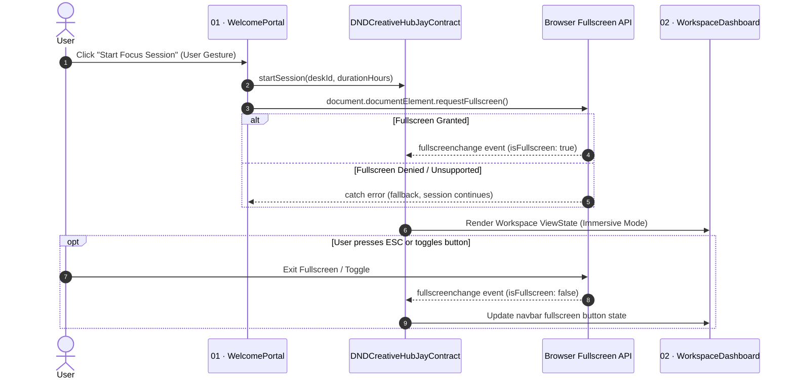

# #0002 - Auto Fullscreen Mode for Deep Work Focus Sessions

## Background
In the DND Creative Hub environment, users initiate a focus block to eliminate digital distractions. While local DNS filtering intercepts non-whitelisted web domains, desktop environmental distractions (such as the operating system taskbar, unread notification badges, and browser tab strips) frequently tempt users away from deep focus.

When a user commits to starting a session from Screen 01 (`WelcomePortal`), entering the browser's native Fullscreen Mode provides an immersive, kiosk-like desktop experience that removes the OS taskbar and browser chrome.

## Problem
Currently, initiating a session transitions state to `workspace` without triggering native browser fullscreen capabilities:
1. The user's operating system taskbar, dock, and notification tray remain visible.
2. Other browser tabs and address bars remain easily clickable, reducing focus retention.
3. The application lacks state tracking and event synchronizers for fullscreen transitions, meaning any manual exit via `Esc` leaves the UI unaware of its display mode.

## Questions and Answers

### Q1: Can a web application trigger fullscreen automatically without user interaction?
**A1:** No. Modern web security standards mandate that `Element.requestFullscreen()` can only be called in response to an explicit user activation gesture (e.g., clicking the "Start Focus Session" button). Therefore, triggering fullscreen directly inside the `onStartSession` submit handler satisfies this constraint.

### Q2: What happens if fullscreen is blocked or unsupported (e.g., automated test runners, iframes, mobile devices)?
**A2:** The fullscreen helper must wrap `requestFullscreen()` in a graceful `try...catch` block with fallback handling. If the request is rejected or unsupported, the session state machine still proceeds to `workspace` seamlessly without crashing.

### Q3: How should fullscreen state be kept synchronized if the user presses `Esc`?
**A3:** A document-level event listener on `'fullscreenchange'` will immediately update `viewState.isFullscreen`. In addition, a dedicated fullscreen toggle icon button will be provided in the `WorkspaceDashboard` top navigation bar so the user can re-engage fullscreen at any point.

---

## Design

### Fullscreen Transition Flow



### JayContract and ViewState Definitions

#### File: `src/contracts/sessionContract.ts`

```typescript
export interface HubViewState {
  // Existing fields...
  screen: ScreenState;
  activeTab: DashboardTab;
  deskId: string;
  selectedDurationHours: number;
  
  // Fullscreen State
  isFullscreen: boolean;
  fullscreenSupported: boolean;
  
  // Remaining fields...
}

export interface HubActionsContract {
  // Existing actions...
  startSession: (deskId: string, durationHours: number) => boolean;
  // Fullscreen actions
  requestFullscreen: () => Promise<boolean>;
  exitFullscreen: () => Promise<boolean>;
  toggleFullscreen: () => Promise<void>;
}
```

### Validation Rules

1. **User Gesture Requirement**:
   - `requestFullscreen()` must be initiated directly by user interaction (button click or form submission).
2. **Graceful Fallback**:
   - If `document.fullscreenEnabled` is false or `requestFullscreen` throws/rejects, `isFullscreen` remains `false` and `startSession` returns `true` without halting session initialization.
3. **Session Teardown**:
   - Upon `resetSession()` or `completeSession()`, if `document.fullscreenElement` is active, the application invokes `document.exitFullscreen()` gracefully.

---

## Implementation Plan

### Step 1: Write TDD Tests First
- Add tests in `src/tests/useHubSession.test.ts` for fullscreen state initialization, `requestFullscreen`, `exitFullscreen`, and `toggleFullscreen`.
- Add tests in `src/tests/WorkspaceDashboard.test.tsx` verifying the fullscreen toggle button and state display.
- Add test in `src/tests/WelcomePortal.test.tsx` confirming that `onStartSession` is dispatched with user gesture context.

### Step 2: Implement Browser Fullscreen Utility
- Create `src/utils/fullscreen.ts` with cross-browser compatible helpers:
  - `isBrowserFullscreen(): boolean`
  - `enterFullscreen(): Promise<boolean>`
  - `leaveFullscreen(): Promise<boolean>`
  - `isSupportedFullscreen(): boolean`

### Step 3: Integrate with useHubSession and JayContract
- Add `isFullscreen` and `fullscreenSupported` to `HubViewState`.
- Hook up `document.addEventListener('fullscreenchange', ...)` to keep state synchronized.
- Provide `toggleFullscreen` in `HubActionsContract`.

### Step 4: Update UI Components
- Update `WelcomePortal.tsx` to invoke fullscreen helper on submission.
- Add an interactive Fullscreen Toggle button (with `Maximize` / `Minimize` Lucide icons) to `WorkspaceDashboard.tsx` header.
- Automatically exit fullscreen when completing or resetting session in `SessionSummary.tsx`.

### Step 5: Verification & Production Build
- Run all Vitest suites.
- Verify `npm run build` passes with zero type errors.

---

## Examples

### Starting a Session with Fullscreen Trigger
✅ **Valid:**
```typescript
// Click handler in WelcomePortal
const handleStart = async (e: React.FormEvent) => {
  e.preventDefault();
  await enterFullscreen(); // Requests fullscreen during user gesture
  actions.startSession(deskId, duration); // ViewState transitions to 'workspace'
};
```

❌ **Invalid:**
```typescript
// Attempting to call requestFullscreen asynchronously after delay or without user gesture
setTimeout(() => {
  document.documentElement.requestFullscreen(); // Browser blocks: "Failed to execute 'requestFullscreen' on 'Element': API can only be initiated by a user gesture."
}, 3000);
```

---

## Trade-offs

1. **Automatic Fullscreen vs User Confirmation:**
   - *Choice:* Trigger fullscreen automatically upon clicking "Start Focus Session".
   - *Rationale:* Matches user expectation for a deep-work distraction-free kiosk mode. The user can easily press `Esc` or click the navbar toggle at any time.

2. **Native Fullscreen API vs Faux CSS Window Maximization:**
   - *Choice:* Use browser native Fullscreen API (`Element.requestFullscreen()`).
   - *Rationale:* CSS can only hide browser inner elements, but native Fullscreen removes the operating system taskbar, desktop notification dock, and browser tab bar completely.

---

## Implementation Results

### Test Execution Summary
- **Test Runner**: Vitest v2.1.9
- **Total Test Suites**: 8 passed (8 total)
- **Total Tests**: 45 passed (45 total)
- **New Test Suites Added**:
  - `src/tests/fullscreen.test.ts` (6 tests): Validating browser support query, `document.fullscreenElement` state reporting, enter/leave fullscreen dispatch, and error isolation on permission denial.
  - Fullscreen assertion extensions in `useHubSession.test.ts`, `WorkspaceDashboard.test.tsx`, and `WelcomePortal.test.tsx`.

### Production Build
- **Status**: Successful, code 0.
- **Bundle**:
  - `dist/assets/index-BW8kezEC.js`: 196.99 kB (gzip: 57.64 kB)
  - `dist/assets/index-Dg8TSl9t.css`: 25.67 kB (gzip: 5.34 kB)

### Summary of Deviations
1. **Synchronous Transition with Non-blocking Fullscreen Promise**:
   - *Initial Plan*: `await enterFullscreen()` inside form submission before `onStartSession`.
   - *Deviation*: Waiting for the browser's asynchronous fullscreen promise caused microtask delays in state transition dispatching.
   - *Resolution*: Invoked `enterFullscreen().catch(...)` synchronously in the same user gesture call stack without blocking `onStartSession()`, enabling instant UI state progression while immediately requesting browser fullscreen.

2. **Bidirectional State Sync & Header Toggle**:
   - In addition to auto-entering fullscreen on start, added document event listeners (`fullscreenchange`, `webkitfullscreenchange`, `mozfullscreenchange`) and a header toggle control (`Maximize2`/`Minimize2`) so users can re-enter fullscreen after pressing `Esc` without leaving their session.

